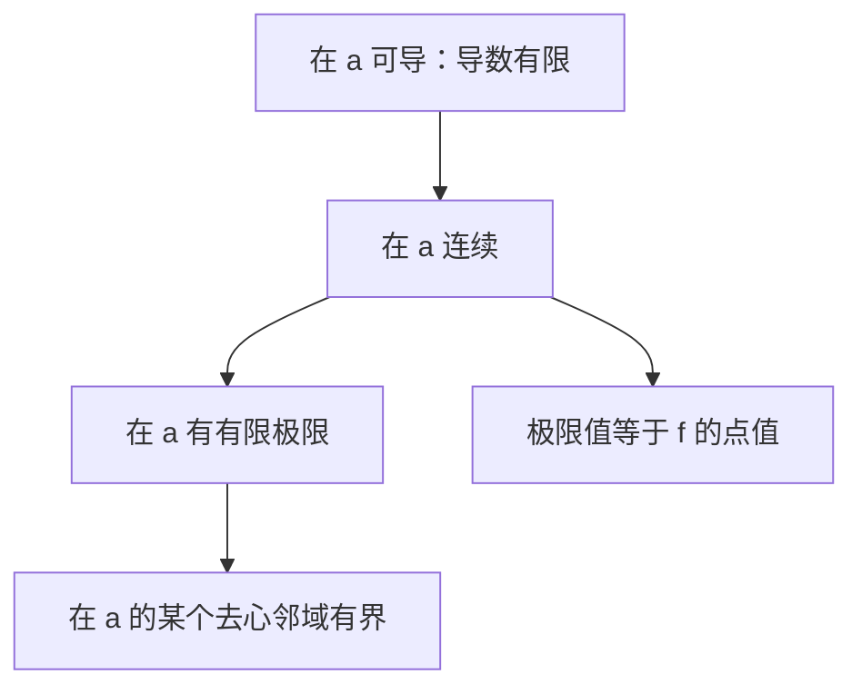

# 数列、函数极限、连续、间断、可导与有界性

适用范围：一元实函数与实数列，按大学高等数学的常见约定讲解。除非明确写“无穷极限”，文中的“极限存在”都指**有限实数极限存在**。函数在某点的双侧讨论默认该点左右都有定义域中的点任意接近；端点改用定义域内的单侧讨论。

## 1. 先分清：每个问题究竟在问什么？

| 概念 | 真正在问 | 是否关心点上的函数值 |
| --- | --- | --- |
| 数列极限 | 当项数越来越大，后面的所有项能否稳定靠近同一个数？ | 有限个前面的项不影响极限 |
| 函数极限 | 当自变量靠近某点但不等于它，函数值能否稳定靠近同一个数？ | 不关心该点的值，甚至可以未定义 |
| 连续 | 靠近该点时的函数值，能否接上该点的函数值？ | 必须关心 |
| 可导 | 在该点的差商能否稳定靠近一个有限数，即是否存在有限的瞬时变化率？ | 必须关心 |
| 有界 | 在指定范围内，所有函数值或数列项能否被同一个有限常数框住？ | 取决于指定范围是否含该点 |

**有界看“能不能框住”，极限看“能不能稳定靠近”。能框住不代表会靠近。**

## 2. 数列极限：存在条件与判断

### 2.1 定义：后面所有项都要靠近

数列 $a_n$ 收敛于 $A$，写作 $\lim_{n\to\infty}a_n=A$，含义为：

$$
\forall\varepsilon>0,\ \exists N\in\mathbb N,\ \forall n>N,\quad |a_n-A|<\varepsilon.
$$

“有无穷多项靠近”不够，必须是“从某项开始，所有项都靠近”。

例如 $(-1)^n$ 有无穷多项等于 $1$，但另外无穷多项等于 $-1$，所以不收敛。

### 2.2 存在条件：分清充要条件和充分条件

| 条件或定理 | 能得到什么 | 注意 |
| --- | --- | --- |
| 柯西准则 | 数列收敛的充要条件 | 适用于实数列，不必先知道极限是多少 |
| 单调且有界 | 一定收敛 | 是常用充分条件，收敛数列不一定单调 |
| 有界 | 只能保证存在收敛子列 | 不能保证原数列收敛 |
| 夹逼：$b_n\le a_n\le c_n$，且两端都趋于 $A$ | $a_n\to A$ | 不等式从某项以后成立即可 |

柯西准则的准确表述：

$$
\forall\varepsilon>0,\ \exists N,\ \forall m,n>N,\quad |a_n-a_m|<\varepsilon.
$$

直观意思：后面的项彼此越来越挤在一起。

单调有界定理具体是：单调递增且有上界，或单调递减且有下界，必有有限极限。例如 $1-1/n$ 递增且小于 $1$，极限为 $1$。

### 2.3 做题顺序

1. 显式表达式先尝试化简、四则运算、夹逼等方法。例如 $\sin n/n\to0$，因为绝对值不超过 $1/n$。
2. 递推数列通常先证明有界、单调，再证明收敛，最后设极限并代入求值。**仅设极限并解出一个数，不证明极限存在。**
3. 怀疑不收敛，找两个极限不同的子列，或证明无界。

例：$a_n=(-1)^n$ 的偶数项子列趋于 $1$、奇数项子列趋于 $-1$，故原数列不收敛。

任何收敛数列的所有子列都收敛于同一极限。但只检查奇、偶子列就断言一般数列收敛，需要它们都收敛且极限相同；只发现一个收敛子列远远不够。

## 3. 函数极限：存在条件与判断

### 3.1 定义：看附近，不看点上

$$
\lim_{x\to a}f(x)=L
\iff
\forall\varepsilon>0,\ \exists\delta>0,\quad
0<|x-a|<\delta\Rightarrow |f(x)-L|<\varepsilon.
$$

这里的 $x$ 限于定义域。$0<|x-a|$ 特意排除了 $x=a$。

例如 $f(x)=(x^2-1)/(x-1)$ 在 $x=1$ 未定义，但 $\lim_{x\to1}f(x)=2$。

### 3.2 双侧极限存在的充要条件

$$
\boxed{\lim_{x\to a}f(x)=L
\iff \lim_{x\to a^-}f(x)=\lim_{x\to a^+}f(x)=L\in\mathbb R.}
$$

左右极限必须**都存在、有限、相等**。分段函数、绝对值函数优先用这一条。

| 左边情况 | 右边情况 | 双侧有限极限 |
| --- | --- | --- |
| 都是同一有限数 $L$ | 都是同一有限数 $L$ | 存在，为 $L$ |
| 有限数 $L_1$ | 不同有限数 $L_2$ | 不存在 |
| $+\infty$ | $+\infty$ | 无有限极限，但可写双侧无穷极限为 $+\infty$ |
| $-\infty$ | $+\infty$ | 不存在，且不能写成统一的带符号无穷极限 |
| 任意一侧振荡且无极限 | 任意情况 | 不存在 |

### 3.3 数列和函数之间的桥梁：海涅定理

$\lim_{x\to a}f(x)=L$ 当且仅当：对**每一个**满足 $x_n\to a$、$x_n\ne a$ 且位于定义域中的数列，都有 $f(x_n)\to L$。

用法：证明函数极限不存在时，只需找到两条趋近路线，使函数值趋于不同的数。

例如 $f(x)=\sin(1/x)$，取

$$
x_n=\frac1{2\pi n+\pi/2},\qquad y_n=\frac1{2\pi n+3\pi/2}.
$$

两者都趋于 $0$，但 $f(x_n)=1$、$f(y_n)=-1$，所以在 $0$ 处无极限。它虽然有界，但始终在振荡。

### 3.4 常用判断方法

1. 在已知连续的点可直接代入；不能把“直接代入”当成对任意函数都成立的规则。
2. 遇到 $0/0$ 等未定式，先因式分解、约分、有理化，或使用适用的重要极限、等价无穷小。
3. 分段、绝对值：分别求左右极限。
4. 振荡项：尝试夹逼；夹不出同一极限，再考虑选取不同趋近数列。
5. 洛必达法则必须先检查未定式类型及定理要求；导数之比没有极限时，不能据此断言原式也没有极限。

自变量趋于 $\infty$ 时，判断结构类似；但此时讨论的是远处行为，不是有限点处的连续性。

## 4. 连续与间断：把“附近”与“点上”接起来

### 4.1 连续的三个条件

$f$ 在 $a$ 处连续，当且仅当：

1. $f(a)$ 有定义；
2. $\lim_{x\to a}f(x)$ 存在且有限；
3. $\lim_{x\to a}f(x)=f(a)$。

这三个条件必须同时成立。常用一句话：**极限值等于函数值。**

在定义域端点只要求相应的单侧连续。若使用“相对于定义域的连续性”，也应始终让 $x$ 在定义域内趋近。

### 4.2 间断点分类

在高数常见题目中，$a$ 是定义域内的点，或是邻近有定义但该点缺失、需要考察补定义的点。严格采用“连续性只在定义域内讨论”的教材，可能把后一种情形称为缺失点；以下沿用常见的间断点分类。

| 类型 | 判断条件 | 例子：考察 $0$ |
| --- | --- | --- |
| 可去间断点 | 左右极限为同一有限数，但点值未定义或不等于该数 | $f(x)=\sin x/x$（$x\ne0$）；补 $f(0)=1$ 后连续 |
| 跳跃间断点 | 左右极限都有限，但不相等 | $x<0$ 时为 $-1$，$x\ge0$ 时为 $1$ |
| 无穷间断点 | 至少一侧为无穷极限 | $f(x)=1/x$ |
| 振荡间断点 | 振荡导致至少一侧连无穷极限也不存在 | $f(x)=\sin(1/x)$ |

可去、跳跃属于**第一类间断点**；至少一个单侧有限极限不存在的，属于**第二类间断点**，包括无穷、振荡等情况。

注意：第二类不能一概叫“振荡”；无界函数也不一定有无穷极限。

### 4.3 分段函数含参数：先连续，再考虑可导

例如

$$
f(x)=\begin{cases} ax+b,&x<0,\\x^2+1,&x\ge0.\end{cases}
$$

在 $0$ 连续要求 $b=1$。此时再比较左右导数，左侧为 $a$，右侧为 $0$，所以可导要求 $a=0$。最终：连续只需 $b=1$；可导需 $b=1$ 且 $a=0$。

## 5. 导数存在：真正判断的是差商的有限极限

### 5.1 定义与充要条件

$$
f'(a)=\lim_{h\to0}\frac{f(a+h)-f(a)}h\in\mathbb R.
$$

在内点，可导当且仅当左右导数都存在、有限且相等：

$$
f'_-(a)=f'_+(a)\in\mathbb R.
$$

**函数的左右极限相等，判断的是极限存在；差商的左右极限相等，判断的是可导。** 两者别混淆。

### 5.2 做题步骤

1. 检查 $f(a)$ 是否定义。
2. 检查连续性；不连续必不可导。
3. 连续时还不能停止，继续计算左右差商，确认其有限且相等。
4. 普通表达式在求导法则适用处直接求导；分段连接点、含振荡的补定义点，优先回到定义。

只比较分段公式的“导函数在连接点附近的极限”，不能跳过连续性。左右导数必须通过包含真实 $f(a)$ 的差商来理解。

### 5.3 三个典型反例

**连续但不可导：** $f(x)=|x|$ 在 $0$ 连续，但左导数为 $-1$、右导数为 $1$，形成尖角。

**差商趋于无穷也不算通常意义的可导：** $f(x)=x^{1/3}$ 在 $0$ 的差商为 $1/h^{2/3}\to+\infty$，没有有限导数。

**可导但导函数不连续，甚至附近无界：**

$$
f(x)=\begin{cases}x^2\sin(1/x^2),&x\ne0,\\0,&x=0.\end{cases}
$$

在 $0$ 的差商为 $h\sin(1/h^2)\to0$，所以 $f'(0)=0$。但 $x\ne0$ 时

$$
f'(x)=2x\sin(1/x^2)-\frac2x\cos(1/x^2).
$$

取 $x_n=1/\sqrt{2\pi n}$，则 $f'(x_n)=-2/x_n\to-\infty$，故导函数在 $0$ 附近无界。

所以，“$f$ 可导”不意味着“$f'$ 连续”或“$f'$ 局部有界”；但 $f$ 自身在该点连续，因此自身局部有界。

## 6. 有界、无界与无穷极限：最容易混的部分

### 6.1 有界性必须写清范围

在集合 $D$ 上有界，指

$$
\exists M>0,\ \forall x\in D,\quad |f(x)|\le M.
$$

在 $D$ 上无界，就是上述命题的否定：

$$
\forall M>0,\ \exists x\in D,\quad |f(x)|>M.
$$

数列只需把 $x\in D$ 换成 $n\in\mathbb N$。有上界与有下界同时成立，才叫有界。

| 范围 | 意思 | 例子 |
| --- | --- | --- |
| 全局有界 | 整个指定定义域内统一被框住 | $\sin x$ 在 $\mathbb R$ 上有界 |
| 在 $a$ 附近局部有界 | 存在某个邻域，在里面能统一框住 | $x$ 在每个有限点附近有界，但在 $\mathbb R$ 上无界 |
| 在 $a$ 的去心邻域局部有界 | 存在 $\delta,M>0$，使 $0<|x-a|<\delta$ 时 $|f(x)|\le M$ | 有限极限存在必然具有这一性质 |
| 在 $a$ 附近无界 | 任意小的去心邻域内都无界 | $1/x$ 在 $0$ 附近无界 |

最后一行严格写作：对任意 $\delta>0$、任意 $M>0$，都存在定义域内的 $x$，使 $0<|x-a|<\delta$ 且 $|f(x)|>M$。

### 6.2 无界不等于趋于无穷

| 性质 | 量词的直观意思 |
| --- | --- |
| 数列无界 | 任意大的框，总有某些项冲出去 |
| $a_n\to+\infty$ | 对任意阈值，后面所有项最终都超过它 |
| $a_n\to-\infty$ | 对任意负阈值，后面所有项最终都低于它 |
| $|a_n|\to\infty$ | 后面所有项的绝对值最终都任意大，符号可以交替 |

反例：$a_n=n(1+(-1)^n)/2$，奇数项为 $0$，偶数项为 $n$。它无界，但既不趋于 $+\infty$，也不满足 $|a_n|\to\infty$。

$a_n=(-1)^n n$ 则满足 $|a_n|\to\infty$，但既不趋于 $+\infty$ 也不趋于 $-\infty$。

函数也一样：

- $1/x^2$ 在 $x\to0$ 时趋于 $+\infty$。
- $1/x$ 在 $0$ 附近无界，左右分别趋于 $-\infty$ 和 $+\infty$，双侧没有统一的带符号无穷极限，但 $|1/x|\to\infty$。
- $\sin(1/x)/x$ 在 $0$ 的任意去心邻域内无界，却也有无穷多个趋于 $0$ 的零点，所以连绝对值都不趋于无穷。

函数趋于 $+\infty$ 的准确含义是：任给 $M>0$，存在 $\delta>0$，使**所有**满足 $0<|x-a|<\delta$ 的定义域内的 $x$ 都有 $f(x)>M$。与“附近总能找到一些大值”不同。

### 6.3 两个重要的有界性定理

**有限极限的局部有界性：** 若 $f(x)\to L\in\mathbb R$，取误差为 $1$，则足够靠近时 $|f(x)|\le |L|+1$。因此任意去心邻域都无界可直接否定该点的有限极限。

**闭区间连续函数有界：** 若 $f$ 在有限闭区间 $[a,b]$ 上连续，则有界且取得最大、最小值。闭、有界、整个区间上连续这些条件不能随意删去。例如 $1/x$ 在 $(0,1)$ 连续却无界；$x$ 在 $\mathbb R$ 上连续却无界。

## 7. 关系总图：箭头只能顺着用

以下讨论同一个内点 $a$：

| 正确命题 | 逆命题为什么不成立 |
| --- | --- |
| 可导 ⇒ 连续 | $|x|$ 在 $0$ 连续但不可导 |
| 连续 ⇒ 有限极限存在 | $x\ne0$ 时为 $1$、$x=0$ 时为 $2$：极限存在但不连续 |
| 有限极限存在 ⇒ 局部有界 | $\sin(1/x)$ 在 $0$ 附近有界但无极限 |
| 数列收敛 ⇒ 数列有界 | $(-1)^n$ 有界但不收敛 |
| 无穷极限 ⇒ 相应范围内无界 | 上面的零项与大项交替数列无界但不趋于无穷 |

可以使用逆否命题：

- 不连续 ⇒ 不可导。
- 有限极限不存在 ⇒ 不连续（在讨论该点连续性的前提下）。
- 在该点任意去心邻域都无界 ⇒ 该点无有限极限 ⇒ 不可能连续或可导。
- 数列无界 ⇒ 不收敛于有限实数。

但“不可导 ⇒ 不连续”“无极限 ⇒ 无界”“数列不收敛 ⇒ 无界”都错误。

## 8. 一张表同时比较

下表均考察 $x\to0$。需要时按表中说明定义 $f(0)$。

| 函数 | 有限极限 | 在 $0$ 连续 | 在 $0$ 可导 | $0$ 附近有界 |
| --- | --- | --- | --- | --- |
| $x^2$ | $0$ | 是 | 是，导数为 $0$ | 是 |
| $|x|$ | $0$ | 是 | 否，左右导数不同 | 是 |
| $x\ne0$ 时为 $1$，$f(0)=2$ | $1$ | 否，可去间断 | 否 | 是 |
| $x<0$ 为 $-1$，$x\ge0$ 为 $1$ | 不存在 | 否，跳跃间断 | 否 | 是 |
| $x\ne0$ 时为 $\sin(1/x)$，$f(0)=0$ | 不存在 | 否，振荡间断 | 否 | 是 |
| $x\ne0$ 时为 $1/x^2$，$f(0)=0$ | 无有限极限，趋于 $+\infty$ | 否，无穷间断 | 否 | 否 |
| $x\ne0$ 时为 $x\sin(1/x)$，$f(0)=0$ | $0$ | 是 | 否，差商 $\sin(1/h)$ 振荡 | 是 |
| $x\ne0$ 时为 $x^2\sin(1/x^2)$，$f(0)=0$ | $0$ | 是 | 是，导数为 $0$ | 是，但导函数附近无界 |

## 9. 遇到一道题，照这个顺序做

1. **先定对象和范围**：数列还是函数？趋于某点还是无穷远？双侧还是单侧？问局部有界还是整个区间有界？
2. **求极限**：代入有依据吗？需要化简、夹逼、分左右，还是找两个子列否定？
3. **判连续**：点值定义了吗？有限极限存在吗？两者相等吗？
4. **分间断**：左右有限极限都存在吗？若相等是可去，不等是跳跃；否则看无穷、振荡等第二类情况。
5. **判可导**：先连续，再算差商；左右差商必须收敛于同一个有限数。
6. **判有界**：证明有界要找统一的界；证明无界要对任意大的界找到越界点。别把“某处大”当成无界。

## 10. 自测：检查是否真的分清了

1. 数列有界就收敛吗？
2. 函数在 $a$ 的极限存在，$f(a)$ 一定有定义吗？
3. 函数在 $a$ 连续，就一定可导吗？
4. 函数无界，就一定趋于 $+\infty$ 或 $-\infty$ 吗？
5. 函数可导，它的导函数就一定连续吗？
6. 函数在某点连续，就一定在整个定义域有界吗？

答案全部是“不一定”。依次可用 $(-1)^n$、$\sin x/x$ 在 $0$ 的缺失点、$|x|$、$\sin(1/x)/x$、第 5.3 节的振荡函数、$f(x)=x$ 在 $\mathbb R$ 上作为反例。

建议先记住关系箭头，再亲手算 $|x|$、$\sin(1/x)$、$x\sin(1/x)$ 的极限和差商。这三个例子能把“极限—连续—可导—有界”之间的大部分误区拆开。
