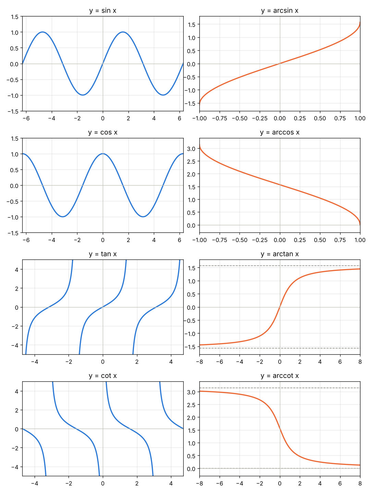

# 知识点 03：三角函数与反三角函数的定义域、值域

- 章节：函数基础 / 反三角函数
- 日期：2026-11-06

## 三角函数

| 函数 | 定义域 | 值域 |
|---|---|---|
| $\sin x$ | $\mathbb{R}$ | $[-1,1]$ |
| $\cos x$ | $\mathbb{R}$ | $[-1,1]$ |
| $\tan x$ | $x\neq k\pi+\dfrac{\pi}{2}$ | $\mathbb{R}$ |
| $\cot x$ | $x\neq k\pi$ | $\mathbb{R}$ |

## 反三角函数

| 函数 | 定义域 | 值域（主值区间） |
|---|---|---|
| $\arcsin x$ | $[-1,1]$ | $\left[-\dfrac{\pi}{2},\dfrac{\pi}{2}\right]$ |
| $\arccos x$ | $[-1,1]$ | $[0,\pi]$ |
| $\arctan x$ | $\mathbb{R}$ | $\left(-\dfrac{\pi}{2},\dfrac{\pi}{2}\right)$ |
| $\operatorname{arccot} x$ | $\mathbb{R}$ | $(0,\pi)$ |

## 图像

蓝色为三角函数，橙色为反函数，虚线为水平渐近线。

## 记忆要点

- 反函数的定义域 = 原函数（限制在主值区间上）的值域，反之亦然
- $\arcsin,\arctan$ 值域关于 $0$ 对称（奇函数）；$\arccos,\operatorname{arccot}$ 值域从 $0$ 开始（非奇非偶）
- $\arcsin,\arccos$ 取闭区间；$\arctan,\operatorname{arccot}$ 取开区间（渐近线取不到）
- $\arcsin x+\arccos x=\dfrac{\pi}{2}$，$\arctan x+\operatorname{arccot}x=\dfrac{\pi}{2}$

## 关联
- [[知识点01_反函数重要关系]]
- [[知识点_常用导数公式]]
