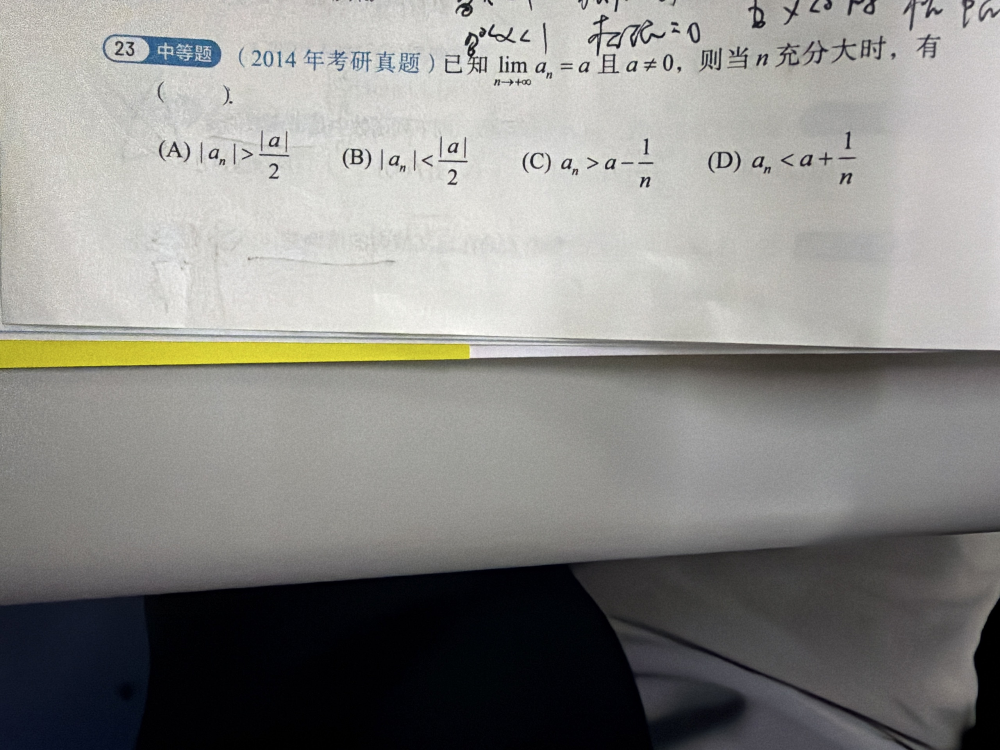

# 错题 03：数列极限定义与"绝对值托底"

## 原题

（2014 年考研真题）已知 $\lim_{n\to\infty} a_n = a$ 且 $a \neq 0$，则当 $n$ 充分大时，有（　　）

(A) $|a_n| > \dfrac{|a|}{2}$
(B) $|a_n| < \dfrac{|a|}{2}$
(C) $a_n > a - \dfrac{1}{n}$
(D) $a_n < a + \dfrac{1}{n}$

**答案：A**

## 四行法

1. **病根**：概念没懂——没抓住 "$a\neq 0$" 这个条件到底拿来干什么；把"收敛到 $a$"想成了"跟 $a$ 只差一丢丢，随便哪个小量都能卡住"。

2. **错在哪一步**：没意识到 $a \neq 0 \Rightarrow \frac{|a|}{2} > 0$，于是**可以直接取 $\varepsilon = \frac{|a|}{2}$**。极限定义对"任意 $\varepsilon>0$"都成立，取多大、取什么值是我的自由。剩下的就是三角不等式移项。

3. **正确思路**：
   取 $\varepsilon = \frac{|a|}{2} > 0$，则 $\exists N,\ \forall n > N:\ |a_n - a| < \frac{|a|}{2}$。
   由三角不等式：
   $$|a| = |a_n + (a - a_n)| \le |a_n| + |a - a_n| < |a_n| + \frac{|a|}{2}$$
   移项得 $|a_n| > |a| - \frac{|a|}{2} = \frac{|a|}{2}$，即 A。
   - **B 错**：方向反了，$|a_n|$ 是被 $|a|/2$ **托底**（下界），不是被压顶。
   - **C、D 错**：$1/n$ 不是标配的"误差棒"。$\varepsilon$ 和 $1/n$ 没有绑定关系。反例：取 $a_n = 1 + \frac{2}{n}\to 1$，则 $a_n > 1 + \frac{1}{n}$ 恒成立，C 直接翻车。

4. **一句话提醒**：**$a\neq0$ 就是给你一个天然的 $\varepsilon=\frac{|a|}{2}$——收敛数列的绝对值最终被 $\frac{|a|}{2}$ 托底，离 0 有距离；别把 $1/n$ 当成万能尺子。**

## 可迁移的套路（这才是真收获）

极限的"最终性质"全都长一个样：

> $\lim a_n = a$ $\Longrightarrow$ 取 $\varepsilon$ 让它满足某个目的（保号 / 托底 / 落在某邻域内 / 小于某个常数）$\Longrightarrow$ 存在 $N$，$n>N$ 时全都满足。

- **保号性**：$a>0 \Rightarrow$ 最终 $a_n > \dfrac{a}{2} > 0$（取 $\varepsilon = a/2$）。
- **有界性**：最终 $|a_n| < |a| + 1$（取 $\varepsilon = 1$）。
- **托底**：$a\neq0 \Rightarrow$ 最终 $|a_n| > \dfrac{|a|}{2}$（本题）。

看到"$n$ 充分大时"+"某个不等式"，第一反应就该是：**这题给我留了 $\varepsilon$ 的自选权。**

## 常见陷阱

- 把 $\varepsilon$ 当成"必须无穷小"的东西 → 其实它是**任取的正常数**，取大取小都合法，只要能推出想要的结论。
- 把 $1/n$ 当固定误差标准 → 极限只说"充分靠近"，没说以什么速率靠近。$a_n = a + \frac{10}{n}$ 一样合法。
