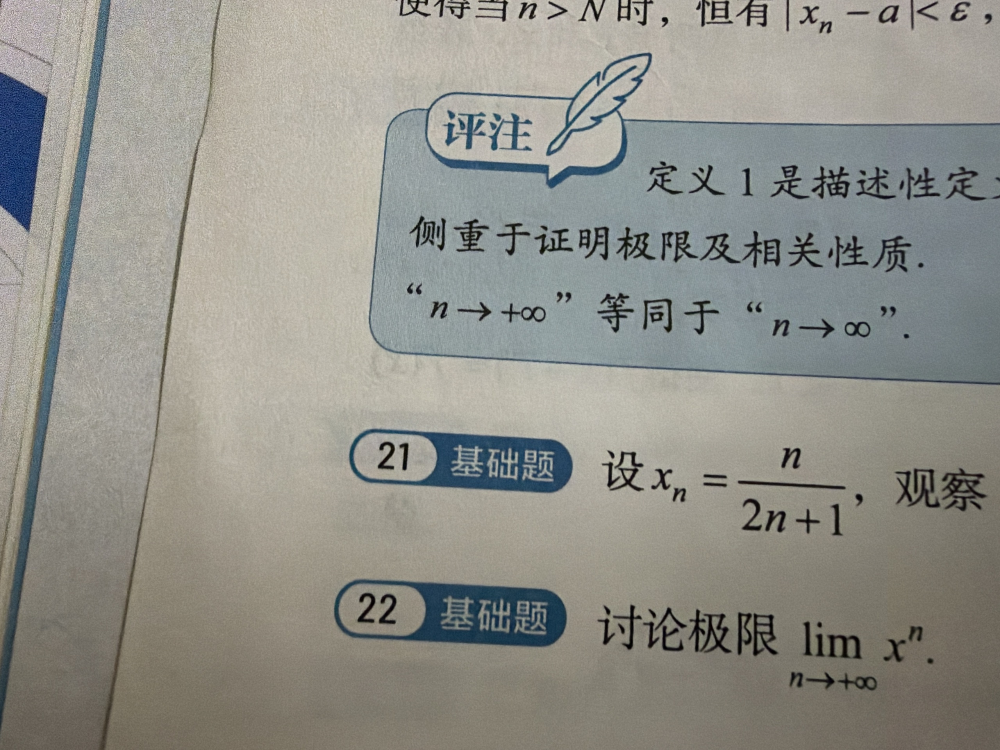

# 错题 04：$\lim x^n$ 的分类讨论——负数区间被误判为"无极限"

## 原题

**22（基础题）** 讨论极限 $\displaystyle\lim_{n\to+\infty} x^n$。

## 四行法

1. **病根**：概念没懂——**把"符号震荡"直接等同于"极限不存在"**。$x^n$ 正负来回跳，于是想当然判定 $-1<x<0$ 时没极限。忽略了极限只看"到 $a$ 的距离"，不看正负号；绝对值被压到 0，符号再怎么跳也逃不出 0。

2. **错在哪一步**：卡在"$x<0$ 时 $x^n$ 符号交替"这一步就停下了，没有继续问一句：**"它离 0 有多远？"** 距离是 $|x|^n$，$|x|<1$ 时距离在缩小，所以就是在逼近 0。

3. **正确思路**（四段分类，按 $|x|$ 与 1 的关系切）：

   | 情况 | 结论 | 理由 |
   |------|------|------|
   | $\|x\|<1$（含 $x=0$、$-1<x<0$） | $\lim x^n = 0$ | 夹逼：$-\|x\|^n \le x^n \le \|x\|^n$，两边都 $\to 0$ |
   | $x=1$ | $\lim x^n = 1$ | 常数列 $1,1,1,\dots$ |
   | $x=-1$ | 极限不存在 | 奇子列 $\to -1$，偶子列 $\to 1$，两子列极限不等 |
   | $\|x\|>1$ | 极限不存在（$\to\infty$） | $x=1+h$ 用伯努利：$(1+h)^n\ge 1+nh\to+\infty$；$x<-1$ 时 $\|x\|^n\to+\infty$ 且符号震荡 |

   **分段速记**：
   $$\lim_{n\to\infty}x^n=\begin{cases}0, & |x|<1\\ 1, & x=1\\ \text{不存在}, & x=-1 \text{ 或 } |x|>1\end{cases}$$

   **$\varepsilon$-$N$ 证明（$0<|x|<1$）**：任给 $\varepsilon>0$，要 $|x|^n<\varepsilon$。取对数 $n\ln|x|<\ln\varepsilon$，因 $\ln|x|<0$，两边除以负数**变号**得 $n>\dfrac{\ln\varepsilon}{\ln|x|}$。取 $N=\left[\dfrac{\ln\varepsilon}{\ln|x|}\right]$，则 $n>N$ 时 $|x^n-0|<\varepsilon$，故极限为 0。
   （注意：$\varepsilon\ge1$ 时上式可能给负的 $N$，取 $N=\max\left(1,\left[\frac{\ln\varepsilon}{\ln|x|}\right]\right)$ 即可。）

4. **一句话提醒**：**看 $x^n$ 先看绝对值——$|x|<1$ 就往 0 钻，管你正负跳成什么样；只有 $x=-1$ 这种"永远不缩小的跳"才是真没极限。**

## 核心心法：这一题真正的收获

> **极限只管"距离"，不管"方向"。**

把这条刻进脑子，以后一堆题都能秒：

- $\lim_{n\to\infty}(-1)^n\frac{1}{n}=0$　（距离 $1/n\to0$，符号跳无所谓）
- $\lim_{n\to\infty}\frac{(-2)^n}{3^n}=0$　（距离 $(2/3)^n\to0$）
- $\lim_{n\to\infty}(-1)^n\frac{n}{n+1}$ **不存在**　（距离是 $\frac{n}{n+1}\to1$，不趋于 0，所以甩不掉）

**统一判据**：$\lim a_n = 0 \iff \lim |a_n| = 0$。而 $\lim a_n = a\neq0$ 时，绝对值**帮不上忙**，得靠子列或直接看。

## 常见陷阱

- **把"有界"当"收敛"**：$(-1)^n$ 有界但发散。有界只是必要条件。
- **$x=-1$ 和 $|x|<1$ 混淆**：$|x|=1$ 是分界**点**，必须单独讨论，不能塞进任何一边。
- **$-1<x<0$ 不会证**：夹逼最省事，$-|x|^n \le x^n \le |x|^n$，一句话收工，千万别去解那个带 $\ln$ 的不等式然后忘了变号。
- **$|x|>1$ 硬刚二项式展开**：浪费时间，伯努利 $(1+h)^n \ge 1+nh$ 一步到位。
- **$x=0$ 单列**：不用，$|x|<1$ 里一句带过，常数列 $0$ 平凡。

## 与错题03的联系

错题03（$a\neq0$ 时 $|a_n|>|a|/2$）和这题是一对：**一个讲"离 0 有距离"（保底下界），一个讲"贴着 0 收敛"（绝对值趋零）**。都是围绕 "$|a_n|$ 与常数 / 0 的关系"做文章。放一起复习效果翻倍。
