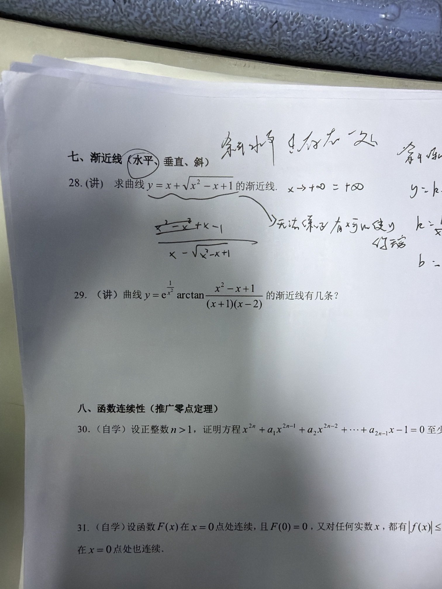

## 原题

第29题：曲线

$$y=e^{\frac{1}{x^2}}\arctan\frac{x^2-x+1}{(x+1)(x-2)}$$

的渐近线有几条？

**答案：2 条**（$y=\dfrac{\pi}{4}$ 和 $x=0$）

## 通用方法：三步走

**先水平 → 再垂直 → 最后斜**

1. **水平**：算 $\lim\limits_{x\to\pm\infty}y$，等于常数 $A$ 就有 $y=A$。
2. **垂直**：找所有无定义点（分母为 0、对数真数为 0 等），逐个算极限，**只有趋于 $\infty$ 的才算**。
3. **斜**：某一侧已有水平渐近线，这一侧就不找斜的；否则算
   $k=\lim\limits_{x\to\infty}\dfrac{y}{x}$，$b=\lim\limits_{x\to\infty}(y-kx)$，二者都存在且 $k\ne0$ 才有 $y=kx+b$。

## 本题过程

**1. 水平渐近线**

$$\lim_{x\to\infty}e^{\frac{1}{x^2}}=e^0=1,\qquad \lim_{x\to\infty}\frac{x^2-x+1}{(x+1)(x-2)}=1$$

$$\lim_{x\to\infty}y=1\cdot\arctan1=\frac{\pi}{4}$$

$y=\dfrac{\pi}{4}$ 两侧都是，所以**没有斜渐近线**。

**2. 垂直渐近线**（可疑点 $x=0,\,-1,\,2$）

- $x=0$：$e^{\frac{1}{x^2}}\to+\infty$，$\arctan$ 部分 $\to\arctan\left(-\tfrac12\right)\ne0$，故 $y\to-\infty$ ✅
- $x=-1$：$e^{\frac{1}{x^2}}\to e$，且 $|\arctan(\cdot)|<\dfrac{\pi}{2}$，$y$ 有界 ❌
- $x=2$：同理 $y$ 有界 ❌

## 错在哪一步

看到 $x=-1,\,2$ 让分母为 0，就直接当成垂直渐近线，没注意外面套了 $\arctan$。

## 一句话提醒

> $-\dfrac{\pi}{2}<\arctan u<\dfrac{\pi}{2}$：**$\arctan$ 会把 $\infty$ 压成有限数**。分母为 0 ≠ 渐近线，一定要算极限是不是 $\infty$。
